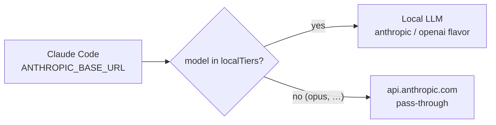

# Claude Code model router

A tiny, zero-dependency proxy that lets Claude Code send **light tasks to your
local LLM** while **everything else goes to the real Anthropic API as usual**.

`ANTHROPIC_BASE_URL` is global — point it at one place and *all* tiers
(Opus/Sonnet/Haiku) go there. This proxy sits in that spot and splits traffic by
the `model` field on each request:



- **Opus / everything not in `localTiers`** → transparent reverse proxy to
  `api.anthropic.com`. Your original auth headers are relayed untouched, so it's
  billed and served exactly as if Claude Code talked to Anthropic directly.
- **Sonnet (default)** → your local model. The proxy speaks either the local
  server's Anthropic API (`localFlavor: "anthropic"`, pure pass-through) or its
  OpenAI Chat Completions API (`localFlavor: "openai"`, full request/response +
  streaming + tool-call translation).

## Quick start

1. **Set your local endpoint** in `router.config.json`:

   ```bash
   cp router.config.example.json router.config.json
   # Edit router.config.json — set localBaseUrl, localModel, localApiKey, etc.
   ```

2. **Run the proxy:**

   ```bash
   npm start            # foreground: node router.mjs
   # …or directly:
   node router.mjs
   ```

   Sanity check: `curl -s localhost:8787/health`

3. **Point Claude Code at it.** This repo ships a ready profile that is a copy of
   your current `~/.claude/settings.json` with only `ANTHROPIC_BASE_URL` added:

   ```bash
   cp ~/.claude/settings.json ~/.claude/settings.json.anthropic   # backup
   cp claude-settings.localrouter.json ~/.claude/settings.json
   ```

   Start a new Claude Code session. To revert:
   `cp ~/.claude/settings.json.anthropic ~/.claude/settings.json`.

## Secrets

`router.config.json` contains your local API key and is listed in `.gitignore`.
Never commit it — use `router.config.example.json` as a template. Alternatively,
set `LOCAL_API_KEY` as an environment variable (see env overrides below).

## Architecture

The proxy is a small set of focused ES modules. `router.mjs` is just the
entrypoint (`loadConfig()` → `startServer()`); the logic lives in `lib/`:

```text
router.mjs              entrypoint
lib/config.mjs          defaults, config-file search chain, env overrides
lib/server.mjs          HTTP server: classify request → route → dispatch → error mapping
lib/router.mjs          pickUpstream(): the routing decision (model → backend)
lib/auth.mjs            upstream auth (relay / OAuth fallback / local-key injection)
lib/http.mjs            fetch-with-timeout, header copy, body reader, URL builders
lib/sse.mjs             the single SSE parser, plus the message → SSE emitter
lib/translate.mjs       Anthropic ↔ OpenAI translation (request, response, streaming)
lib/upstream.mjs        transparent reverse proxy + usage teeing
lib/websearch.mjs       policy for Anthropic's server-side web tools (off / local / always)
lib/oneShot.mjs         one buffered call to either upstream, as an Anthropic message
lib/backends/
  index.mjs             backend-handler registry (the extensibility seam)
  anthropic.mjs         pass-through to api.anthropic.com
  localAnthropic.mjs    pass-through to an Anthropic-flavored local gateway
  localOpenai.mjs       translate to OpenAI Chat Completions (+ streaming)
```

**Routing & dispatch.** For each request, `server.mjs` classifies the URL and
parsed body, calls `pickUpstream(model)` to get either the literal `'anthropic'`
or a local backend config `{ model, baseUrl, flavor, apiKey, tier }`, then hands
a request context to the matching backend handler. The server contains **no
per-flavour branching** — that lives inside each handler behind a single
`handle(ctx)` interface.

**Open for extension.** Backends are plain objects registered by key in
`lib/backends/index.mjs`. Adding a new local flavor (e.g. an Ollama-native
handler) is a new file plus one registry line; the server, router, and existing
handlers are untouched. Adding a tier-to-model mapping is a `localBackends`
entry — no code changes.

**State.** Each request runs in its own `ctx` closure; the only module-level
shared state is the loaded config (set once at startup), a cached OAuth token,
and a tool-id counter. All run on Node's single-threaded event loop, so
concurrent requests interleave only at `await` points — and none of the shared
mutations straddle one. No locks are needed.

Zero dependencies. Requires Node ≥ 18 (uses global `fetch` + web streams).

## Configuration (`router.config.json`)

| Key | Meaning |
| --- | ------- |
| `port` / `host` | Where the proxy listens (default `127.0.0.1:8787`). |
| `anthropicBaseUrl` | Real upstream for non-local traffic. Default `https://api.anthropic.com`. |
| `anthropicUpstreamKey` | Force an Anthropic API key for the upstream instead of relaying Claude Code's auth. Leave `""` to pass through (recommended for subscription/OAuth). |
| `anthropicCredsFallback` | If a request reaches the Anthropic path with no auth header, attach the OAuth token from `~/.claude/.credentials.json`. Best-effort. |
| `localBaseUrl` | Root URL of your local server (no `/v1`). Ollama: `http://127.0.0.1:11434`. |
| `localFlavor` | `"openai"` (Ollama/llama.cpp/LM Studio/vLLM) or `"anthropic"` (an Anthropic-compatible gateway). |
| `localModel` | The model name your local server actually serves. The proxy rewrites the `model` field to this. |
| `localApiKey` | Auth sent to the local server (Ollama ignores it; vLLM/LM Studio may need it). |
| `localTiers` | Substrings that route to local. Default `["sonnet"]`. Add `"haiku"` to also send background tasks local. |
| `localBackends` | Optional per-tier overrides. Array of `{ tier, model, baseUrl?, flavor?, apiKey? }`. |
| `webSearch` | Who serves Claude Code's WebSearch/WebFetch — see [Web tools](#web-tools-websearch--webfetch) below. |
| `countTokens` | `"estimate"` (no Anthropic dependency for the local path) or `"anthropic"`. |
| `logUsage` | Log token usage (input/output + cache) already present in each response. No extra API calls/cost. Default `false`. |
| `usageLogFile` | If set, also append one JSON record per request to this path (for per-session token tallies). |
| `logLevel` | `debug` / `info` / `warn` / `error`. |
| `maxBodyBytes` | Max request body size in bytes. Requests exceeding this get a `413` error. Default `67108864` (64 MB). |
| `upstreamTimeoutMs` | Time-to-first-byte timeout for upstream requests (ms). Only covers the connection + headers phase; once streaming starts, no timeout is applied. Default `120000` (2 minutes). |

Any field can be overridden by env var for one-off runs: `PORT`, `LOCAL_BASE_URL`,
`LOCAL_FLAVOR`, `LOCAL_MODEL`, `LOCAL_API_KEY`, `LOCAL_TIERS`,
`ANTHROPIC_UPSTREAM_URL`, `ANTHROPIC_UPSTREAM_KEY`, `ROUTER_LOG_LEVEL`,
`ROUTER_LOG_USAGE`, `ROUTER_USAGE_LOG_FILE`, `MAX_BODY_BYTES`, `UPSTREAM_TIMEOUT_MS`,
`WEB_SEARCH_MODE`, `SEARXNG_URL`, `CRAWL4AI_URL`, `CRAWL4AI_API_TOKEN`.

## Web tools (WebSearch / WebFetch)

Claude Code's `WebSearch` and `WebFetch` are Anthropic **server tools**: the
request carries only a typed stub — `{"type": "web_search_20250305", "name":
"web_search"}`, no input schema — because the search runs inside Anthropic's own
API, which splices `server_tool_use` / `web_search_tool_result` blocks into the
reply. The client executes nothing. A local gateway has none of that, so on the
local route the stub is at best ignored and at worst a 400.

`webSearch.mode` decides who serves those tools. The three modes differ only in
*which routes* the proxy takes over:

| Mode | Local route (`localTiers` models) | Anthropic route (everything else) |
| ---- | --------------------------------- | --------------------------------- |
| `"off"` | Stubs stripped before the request leaves the proxy, so the model is never offered a tool nobody can run. Streaming untouched. | Untouched — Anthropic's own search runs as usual. |
| `"local"` **(default)** | Each stub swapped for a real function tool the proxy executes: `web_search` against SearXNG, `web_fetch` against crawl4ai. | Untouched — Anthropic's own search runs as usual. |
| `"always"` | Same as `"local"`. | Also served by your SearXNG/crawl4ai, so no query or page URL leaves the network even for Anthropic models. |

When the proxy serves the tools it loops internally — call → search → feed the
results back → call again — and hands the client only the finished answer. The
client never sees a `tool_use` it cannot run.

```json
"webSearch": {
  "mode": "local",
  "searxUrl": "http://127.0.0.1:8888",
  "crawl4aiUrl": "http://127.0.0.1:11235",
  "crawl4aiToken": "<token>"
}
```

Tuning keys: `maxResults` (5), `snippetChars` (400), `fetchChars` (20000),
`maxRounds` (3), `timeoutMs` (30000).

A tool whose endpoint is left empty is not served, so `mode: "local"` with only
`searxUrl` set gives you search and no fetch. What happens to that unserved stub
depends on the route: on the local route it is stripped (nothing there could run
it), on the Anthropic route it is left in place (Anthropic still can). With
neither endpoint configured, every mode behaves like `"off"`.

**Prefer `"off"` plus MCP when you can.** A SearXNG/crawl4ai MCP server gives the
model *client*-side tools, which work on every route, keep streaming intact, and
show up in the transcript as ordinary tool calls. The in-proxy modes exist for
the case where the client isn't Claude Code, or no MCP server is available.

Caveats once the proxy is serving a request's web tools:

- **No incremental streaming on affected requests.** The proxy has to see the
  whole reply before it knows whether a search is needed, so it buffers and
  replays the answer as SSE at the end. Requests that carry no web stub are
  unaffected. In `"always"` this now applies to Anthropic-routed requests too,
  which is the main reason not to switch it on by default.
- **SearXNG must have its JSON API enabled** (`search.formats` in `settings.yml`
  must include `json`); otherwise every search returns an error string telling
  you exactly that.
- **`"always"` costs quality for privacy.** Anthropic's own search is tuned for
  its models and returns citation blocks; a raw SearXNG snippet list is not the
  same thing. Use it when keeping queries on your own network matters more.

### Example: Ollama

```json
{ "localFlavor": "openai", "localBaseUrl": "http://127.0.0.1:11434", "localModel": "qwen2.5-coder:14b", "localApiKey": "ollama" }
```

### Example: an existing Anthropic-compatible gateway on your LAN

```json
{ "localFlavor": "anthropic", "localBaseUrl": "http://10.0.0.10:11111", "localModel": "my-local-model", "localApiKey": "<token>" }
```

## How auth works

The profile deliberately does **not** set `ANTHROPIC_AUTH_TOKEN` / `ANTHROPIC_API_KEY`.
That keeps your subscription OAuth in play: Claude Code attaches it, and the proxy
relays it to `api.anthropic.com` for the Opus path. The local path never sees your
Anthropic credentials — the proxy strips them and injects `localApiKey` instead.

If Opus requests ever come back `401`, you have two fallbacks:

- leave `anthropicCredsFallback: true` (the proxy reads the OAuth token from
  `~/.claude/.credentials.json` when no auth header is present), or
- set `anthropicUpstreamKey` to an API key from `console.anthropic.com`.

## Notes & trade-offs

- **Which tiers go local** is the one knob that matters. Default `["sonnet"]`
  matches "replace Sonnet, keep the rest on Anthropic." Haiku-tier background
  calls (compaction summaries, etc.) stay on Anthropic — they're cheap and a weak
  local model degrades those silently. Add `"haiku"` to `localTiers` if you want
  them local too.

- Routing is by substring on the model id, so `claude-opus-4-8[1m]`,
  `claude-sonnet-4-6`, etc. all classify correctly with no model-name overrides.

- The proxy logs every routing decision at `info` level, e.g.
  `POST /v1/messages model=claude-sonnet-4-6 -> local(anthropic:my-local-model)`.

- **Upstream timeouts** are time-to-first-byte only (default 2 minutes). Once
  the response starts streaming, there is no timeout — long generations are never
  interrupted. If the upstream never responds at all, the proxy returns a `504`.

- **Mid-stream errors** from the upstream are propagated as Anthropic SSE `error`
  events so Claude Code can see the failure instead of receiving a silently
  truncated response.

## Package as a single binary

The proxy compiles to a single self-contained executable — no Node, no
`node_modules`, no project folder needed on the target machine. Build it with
[Bun](https://bun.sh) via the Makefile:

```bash
make           # -> dist/claude-router  (one ~98 MB executable)
make install   # build + copy to ~/.local/bin/claude-router
make dist      # smaller, shippable artifact -> dist/claude-router.xz (~24 MB)
make help      # list all targets
```

(`bun run build` / `bun run build:install` are kept as aliases that call `make`.)

Bun bundles the `router.mjs` entrypoint together with all its `lib/` imports at
compile time, so the modular source tree produces one binary just as the old
single-file version did.

**On size.** The ~98 MB is the bun runtime baked into the binary — that's the
price of "needs nothing installed." It can't be `strip`-ped: bun appends its JS
payload + a locator trailer to the executable, and stripping relocates that
trailer so the binary stops running its own code (it also doesn't shrink it —
the size isn't ELF symbols). To move it around, `make dist` xz-compresses it to
~24 MB; decompress on the target with `xz -d claude-router.xz`. If a small
on-disk footprint matters more than zero dependencies, install the script as a
Node CLI instead (`npm i -g .`, needs Node ≥18 on the box).

Then run it from anywhere:

```bash
claude-router          # reads config from the search chain below
```

**Where it reads config** (first match wins):

1. `$ROUTER_CONFIG` — explicit path (always wins if set)
2. `./router.config.json` — current directory (repo dev)
3. `~/.config/claude-router/config.json` — the installed-service default (XDG)
4. `<binary dir>/router.config.json` — script-adjacent fallback

For an installed binary, put your config at the XDG location:

```bash
mkdir -p ~/.config/claude-router
cp router.config.example.json ~/.config/claude-router/config.json   # then edit
```

The startup banner logs which config file it loaded (or warns if none was found
and it fell back to defaults). All env-var overrides (`PORT`, `LOCAL_BASE_URL`,
…) still apply on top of whichever file is used.

## Install as a systemd service

`make install` does the whole thing — builds the binary, installs it to
`~/.local/bin`, sets up the config, and installs + enables + starts a user-level
systemd service (no root required: auto-restart, journald logs, start-at-boot).
The unit runs the installed binary, so the service is fully decoupled from this
project folder.

```bash
make install
loginctl enable-linger $USER   # optional: keep running after logout
```

What `make install` does:

- **binary** — installs to `~/.local/bin/claude-router`
- **config** — creates `~/.config/claude-router/config.json` if missing: migrates
  an existing `router.config.json`, else copies the example (and warns)
- **service** — installs `claude-router.service` to `~/.config/systemd/user/`,
  then `daemon-reload` + `enable` + `restart` (re-run to upgrade in place)

`make uninstall` stops/disables the service and removes the binary + unit (your
config is kept). View logs: `journalctl --user -u claude-router -f`.

> If something else is already bound to the port (e.g. a `node router.mjs` you
> started by hand), stop it first — otherwise the new service can't bind and will
> crash-loop.

To set `LOCAL_API_KEY` via environment instead of the config file, edit the
`Environment=` line in the service unit.

For a system-level service (e.g. shared across users), copy the unit to
`/etc/systemd/system/claude-router.service` and add `User=krzych` under
`[Service]`.

## Test

```bash
npm test
```

Self-contained mock upstreams — no external services needed. Three suites cover
routing & model rewrite, the OpenAI translation path (streaming + tool calls),
auth stripping, `count_tokens`, and token-usage logging.
